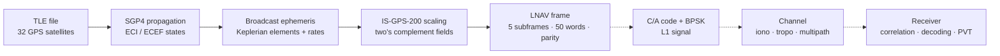

# GPS Signal Simulator

A GPS simulator written in MATLAB/Simulink that builds a GPS signal step by step: from the real constellation orbits to the navigation message bits that a receiver decodes.

> **Status: work in progress.** Phase 1 (orbits) is finished, phase 2 (navigation message) is in progress and phases 3–5 are planned.

## Why

This started from a proposal by my professor of the air navigation course (NACC) at EETAC–UPC: having a signal simulator for the course labs, so students can see how a GPS signal is built and test with it. I also suggested that students could write their own programs to **decode** the simulated signal. It is a personal project, built outside the course labs.

## Pipeline



Solid arrows are implemented; dashed arrows are the next phases.

| Phase | Module | Status |
|---|---|---|
| 1 | Orbital mechanics: SGP4, TLE, ECI/ECEF state | ✅ Done |
| 2 | Navigation message: IS-GPS-200, subframes 1–3, parity | 🔧 In progress |
| 3 | Signal generation: C/A PRN code, BPSK, L1 | ⏳ Planned (early prototype in `prototypes/`) |
| 4 | Channel models: ionosphere, troposphere, multipath | ⏳ Planned |
| 5 | Receiver / PVT: correlator, decoding, WLS | ⏳ Planned |

## What is implemented

**Orbits (`src/orbital`)**
- Loads the constellation from a TLE file into a MATLAB `satelliteScenario` (SGP4 propagation).
- Converts two consecutive ECI states into GPS broadcast ephemeris: Keplerian elements plus the rates (Ω̇, IDOT, Δn) estimated numerically.

**Navigation message (`src/navigation`)**
- Scales each parameter with its IS-GPS-200 scale factor and packs it into two's-complement bit fields (`scale_signed`, `scale_unsigned`).
- Builds the 1500-bit LNAV frame: TLM and HOW words, subframes 1–3 with clock and ephemeris data, and the (32,26) Hamming parity of every word with the D29*/D30* bits carried between words (`add_parity`, `build_nav_frame`).
- `bridge_orbit_to_nav` connects both modules: from two orbital states to a complete binary frame.
- Display tools to show the frame as a bit map and as an NRZ signal.

**Simulink (`simulink/`)**
- `gps_transmitter.slx`: first version of the transmitter model, which packs the orbital data and displays the navigation frame (work in progress).

## Tests

| Test | What it checks |
|---|---|
| `tests/test_orbital.m` | Phase 1: constellation loaded, visible satellites, orbit radius, semi-major axis, eccentricity, inclination, Keplerian reconstruction error and PDOP. |
| `tests/test_gps_complete.m` | Encodes every subframe 1–3 parameter, removes the parity encoding and decodes it back. Each value must match the transmitted integer. |
| `tests/test_bridge_data.m` | Full pipeline from TLE to binary frame. |

Phase 1 results (from the roadmap): 32 satellites loaded, 10 visible from Madrid above 5° elevation, semi-major axis 26,561.9 km, inclination 55.52°, eccentricity 0.0093, Keplerian reconstruction error 0.00 m, PDOP 1.63.

## How to run

Requirements: MATLAB with the **Aerospace Toolbox** (`satelliteScenario`) and Simulink for the transmitter model.

```matlab
cd tests
test_orbital         % phase 1
test_gps_complete    % encode/decode round trip of the navigation message
test_bridge_data     % TLE -> binary frame
```

## Repository structure

```
data/          TLE of the GPS constellation, ICD scale factors, example parameters
src/orbital/   orbit propagation and broadcast ephemeris
src/navigation/ IS-GPS-200 encoding, parity and frame builder (+ display tools)
simulink/      transmitter model
tests/         validation scripts
prototypes/    first prototype: C/A Gold code generation and acquisition experiment
docs/          development roadmap (Spanish) and parity worksheet
```

## References

- IS-GPS-200, *Navstar GPS Space Segment / Navigation User Interfaces* — available at [gps.gov](https://www.gps.gov/technical/icwg/).
- GPS TLE data from [CelesTrak](https://celestrak.org/).

## Author

Andreu Bueno Álvarez — Aerospace Systems Engineering, EETAC–UPC.
